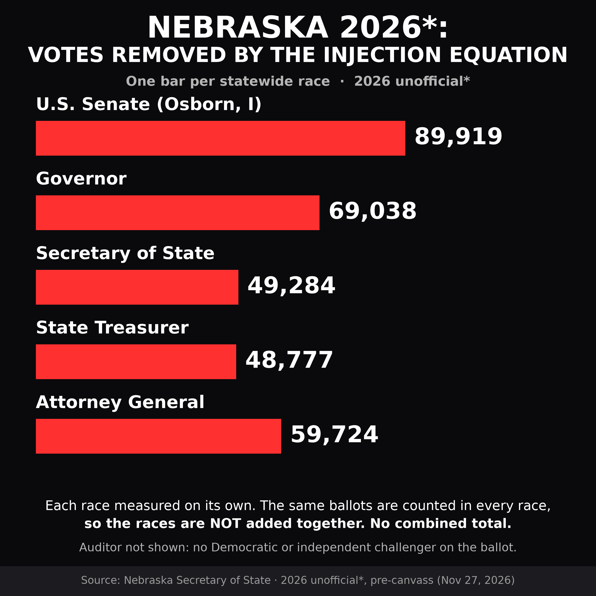
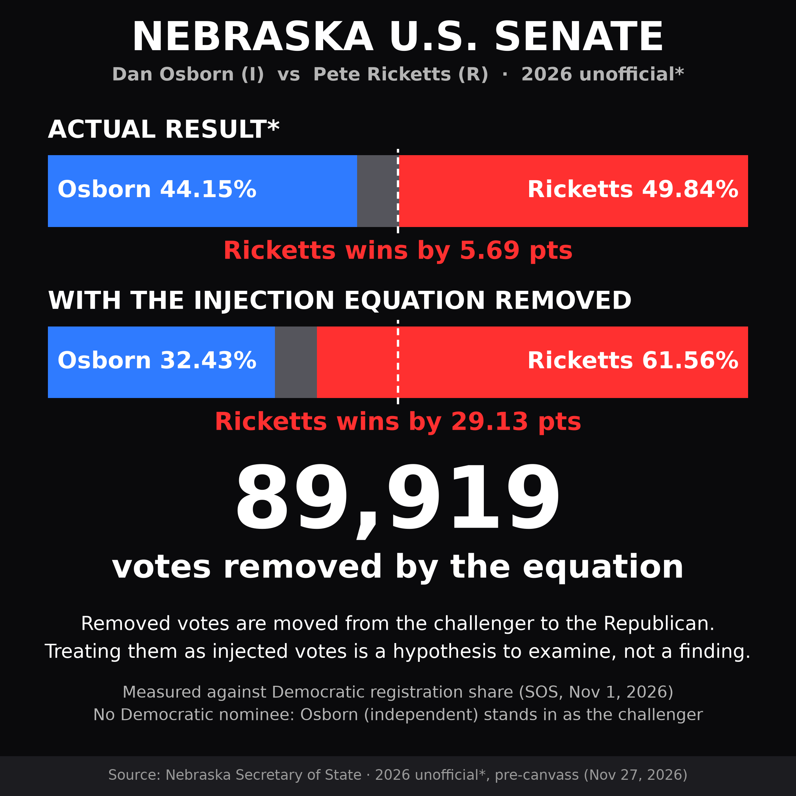
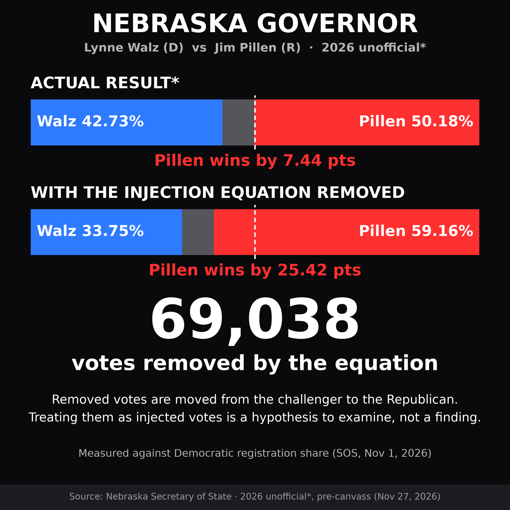
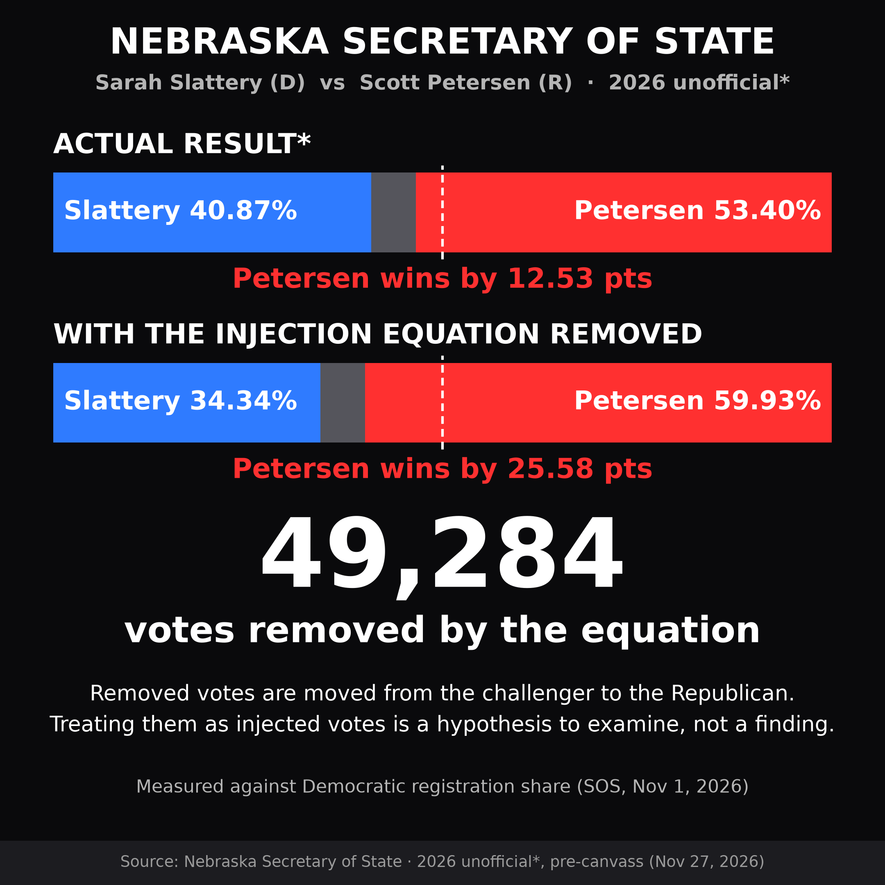
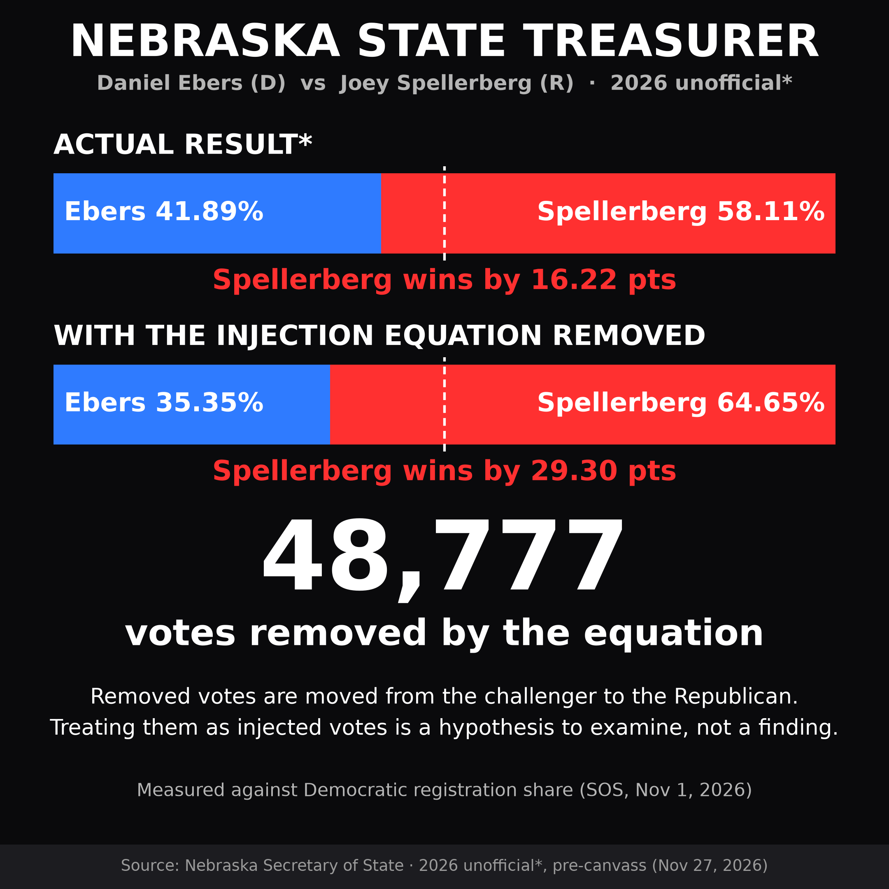
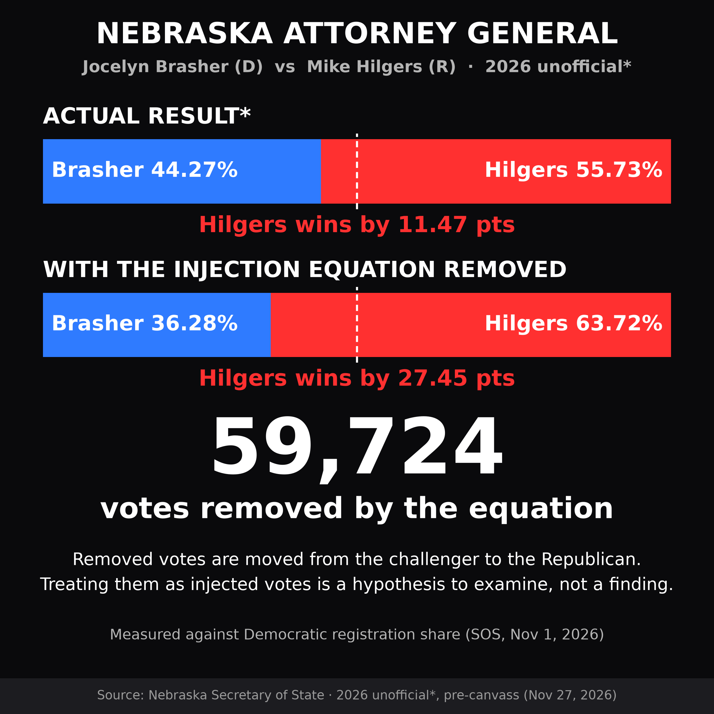
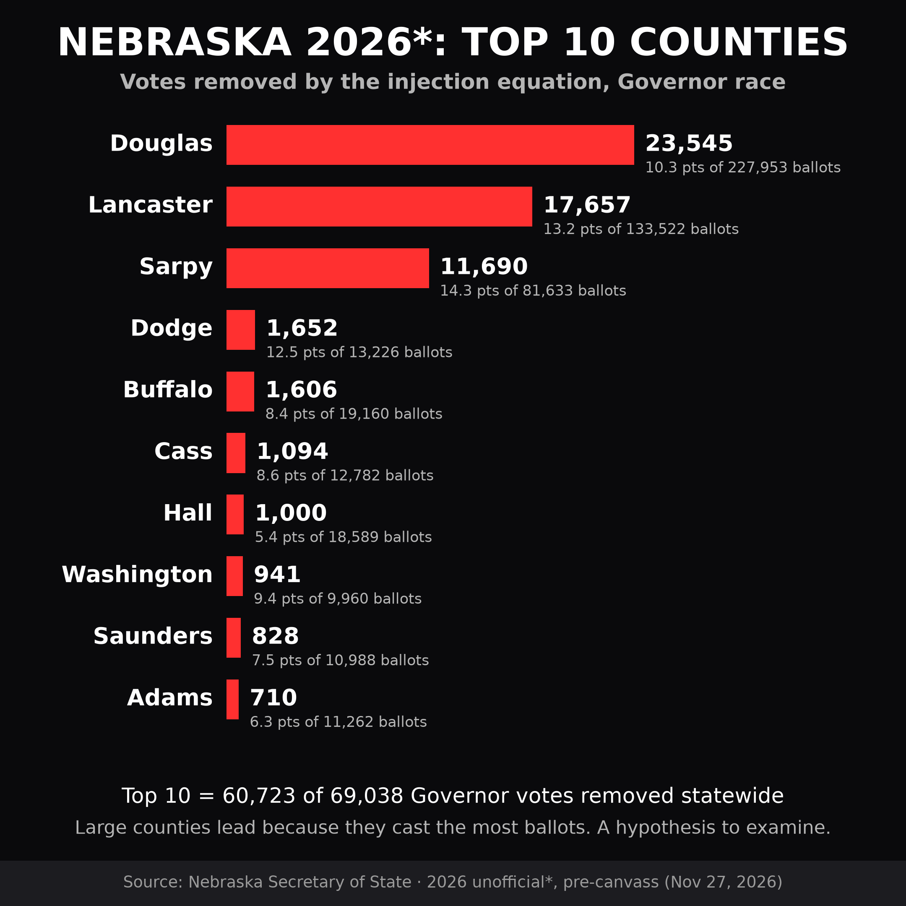

# Nebraska Full Reversal Analysis (2026\*)

> **\*All 2026 figures are UNOFFICIAL.** Nebraska Secretary of State (SOS) results site, "Unofficial Results," county data re-downloaded Nov 27, 2026 10:21–10:24 AM CT (1,322 of 1,322 precincts; 779,787 ballots cast). The State Board of Canvassers meets Nov 30, 2026 at 11:30 AM CT; numbers can still change. Registration: SOS VR Statistics Count Report processed Nov 1, 2026. **Treating the removed votes as injected votes is the analyst's hypothesis.** The arithmetic measures a pattern. It cannot test cause, and nothing here is proof of wrongdoing. PRIVATE working copy: not for publication.

## The locked Nebraska equation

- **D** = Democratic registered voters ÷ all registered voters × 100 (SOS VR report, Nov 1, 2026).
- **S** = Democratic candidate votes ÷ total ballots cast in the county × 100. Denominator: **total ballots cast** (SOS turnout export), used for every race.
- **G (gap)** = S − D, in percentage points.
- **Nebraska line:** G = m × (D/100) + b. **m** is the multiplier (coefficient); **b** is the offset (constant). Fit by ordinary least squares, unweighted, across all 93 counties, Nebraska SOS data only, one fit per race.
- **Locked:** the constants below come from the Nov 27, 2026 10:21 AM CT SOS download. They are frozen for this edition; if the canvass changes the counts, the fit is re-run and the edition number changes.

| Race | Candidates (challenger vs R) | m (multiplier) | **b (offset, pts)** | R² | Counties above line |
|---|---|---|---|---|---|
| [U.S. Senate](Full-Reversal-Senate-Counties.md) | Dan Osborn (independent) vs Pete Ricketts (R) | 22.3099 | **5.7078** | 0.115 | 45 of 93 |
| [Governor](Full-Reversal-Governor-Counties.md) | Lynne Walz / Ben Steffen (D) vs Jim Pillen / Joe Kelly (R) | 27.3807 | **3.1747** | 0.200 | 40 of 93 |
| [Secretary of State](Full-Reversal-Secretary-of-State-Counties.md) | Sarah J. Slattery (D) vs Scott Petersen (R) | 28.1245 | **0.3426** | 0.222 | 43 of 93 |
| [State Treasurer](Full-Reversal-Treasurer-Counties.md) | Daniel Ebers (D) vs Joey Spellerberg (R) | 29.7465 | **1.2905** | 0.277 | 45 of 93 |
| [Attorney General](Full-Reversal-Attorney-General-Counties.md) | Jocelyn Brasher (D) vs Mike Hilgers (R) | 33.5312 | **1.8372** | 0.259 | 45 of 93 |

**Auditor of Public Accounts was not reversed.** The ballot had Mike Foley (R) vs John Knight (America First); there was no Democratic or independent challenger, so the equation has nothing to measure.

**The public wiki's "S = 0.36 × (D/100) + 1.5" was not used.** Re-fitting Nebraska's 93 counties does not reproduce it (Governor 2026\*: m = 27.38, b = 3.17), and no file on hand shows what data or year it was fit on. Treat it as unverified until its source is confirmed.

**Denominator note.** This edition divides by total ballots cast. The public Locked-Nebraska-Formula page divides by the governor-race total (write-ins included). Statewide the governor-race total is 98.52% of ballots, so race-total gaps run slightly higher (for example, Dakota ΔG +19.80\* on the public Locked-Nebraska-Formula page vs +18.94\* here). Use one set; do not mix them.

## Full reversal: residual + offset, county by county

For each county and race: **distance from line** (residual) = G − (m × D/100 + b). **Removal (pts) = residual + b** = the full reversal, not the residual alone. Negative removals are set to 0 (the county is "zeroed"). Removal votes = removal ÷ 100 × ballots. Convention: removed votes are moved from the challenger to the Republican, so race totals do not change (the Kansas "reassign" mode). A remove-only alternative is shown too.

## Statewide before and after

| Race | Before (challenger / R) | Votes removed* | After (challenger / R) | Margin before → after | Winner before → after | Remove-only alternative | Offset share of removal | Counties won by challenger: before → after | Zeroed |
|---|---|---|---|---|---|---|---|---|---|
| U.S. Senate | Osborn 44.15% / Ricketts 49.84% | **89,919** | Osborn 32.43% / Ricketts 61.56% | R +5.69 → R +29.13 | Ricketts → Ricketts | 36.74% / 56.46% | 48.0% | 3 → 0 | 10 |
| Governor | Walz 42.73% / Pillen 50.18% | **69,038** | Walz 33.75% / Pillen 59.16% | R +7.44 → R +25.42 | Pillen → Pillen | 37.08% / 55.13% | 34.6% | 4 → 2 | 13 |
| Secretary of State | Slattery 40.87% / Petersen 53.40% | **49,284** | Slattery 34.34% / Petersen 59.93% | R +12.53 → R +25.58 | Petersen → Petersen | 36.74% / 57.13% | 4.8% | 3 → 2 | 43 |
| State Treasurer | Ebers 41.89% / Spellerberg 58.11% | **48,777** | Ebers 35.35% / Spellerberg 64.65% | R +16.22 → R +29.30 | Spellerberg → Spellerberg | 37.82% / 62.18% | 19.1% | 3 → 1 | 26 |
| Attorney General | Brasher 44.27% / Hilgers 55.73% | **59,724** | Brasher 36.28% / Hilgers 63.72% | R +11.47 → R +27.45 | Hilgers → Hilgers | 39.43% / 60.57% | 22.4% | 4 → 2 | 27 |

Votes, before → after: U.S. Senate: Osborn 338,741 → 248,822, Ricketts 382,401 → 472,320; Governor: Walz 328,306 → 259,268, Pillen 385,502 → 454,540; Secretary of State: Slattery 308,544 → 259,260, Petersen 403,134 → 452,418; State Treasurer: Ebers 312,366 → 263,589, Spellerberg 433,312 → 482,089; Attorney General: Brasher 330,924 → 271,200, Hilgers 416,670 → 476,394.

**No race changes hands.** The Republican already won all five races on the unofficial count; removal widens each margin. Each race is measured on its own: the same ballots are counted in every race, so the race totals are **not** added together.

## Top ten counties (ranked by Governor removal votes), per-race totals

| # | County | Population | CD | Ballots* | Governor | Senate (Osborn) | Sec. of State | Treasurer | Attorney General |
|---|---|---|---|---|---|---|---|---|---|
| 1 | Douglas | 606,460 | CD2 | 227,953 | **23,545** | 28,007 | 18,446 | 17,583 | 21,403 |
| 2 | Lancaster | 334,049 | CD1 | 133,522 | **17,657** | 22,448 | 12,730 | 11,866 | 13,988 |
| 3 | Sarpy | 208,303 | CD1 | 81,633 | **11,690** | 14,001 | 10,200 | 9,814 | 11,374 |
| 4 | Dodge | 38,057 | CD1 | 13,226 | **1,652** | 1,392 | 601 | 127 | 905 |
| 5 | Buffalo | 51,172 | CD3 | 19,160 | **1,606** | 2,319 | 958 | 1,031 | 1,348 |
| 6 | Cass | 27,657 | CD1 | 12,782 | **1,094** | 1,597 | 1,118 | 962 | 1,202 |
| 7 | Hall | 63,633 | CD3 | 18,589 | **1,000** | 1,773 | 556 | 813 | 947 |
| 8 | Washington | 21,302 | CD3 | 9,960 | **941** | 1,180 | 603 | 587 | 798 |
| 9 | Saunders | 23,702 | CD2 | 10,988 | **828** | 1,146 | 430 | 433 | 696 |
| 10 | Adams | 31,071 | CD3 | 11,262 | **710** | 1,197 | 468 | 554 | 687 |
| | **Top 10 total** | | | | **60,723** | 75,060 | 46,110 | 43,770 | 53,348 |
| | **Statewide** | | | | **69,038** | 89,919 | 49,284 | 48,777 | 59,724 |

Each race's own top ten (by its removal votes) is on its county page. The same three counties (Douglas, Lancaster, Sarpy) lead every race because they cast the most ballots.

## Honest notes for defending the method

- **Nebraska's lines are weak fits.** R² runs from 0.115 (Senate) to 0.277 (Treasurer). Registration share explains a fifth to a quarter of the county spread in the Democratic-nominee races.
- **Nebraska's offsets are small.** b = 0.34 to 5.71 pts, against 6.30 in Kansas (2026\*) and about 12–14 in Texas. The offset is under half of every race's removal (4.8% to 48.0%); most of it comes from counties sitting above the line. Texas was the reverse (67–76% offset).
- **The ceiling counties are zeroed in the level fit.** Dakota, Thurston and Colfax have the largest 2022→2026\* ΔG (the change), but their 2026\* gap sits below the line because their Democratic registration share is high. Full reversal works on the 2026 level, so it removes nothing there. ΔG and full reversal measure different things.
- **Large counties dominate the vote totals.** Douglas, Lancaster and Sarpy sit well above the line, and they cast 57% of ballots.

## Verification (two independent passes)

Pass A: pandas, statsmodels, pdfplumber (VR PDF), openpyxl (turnout xlsx). Pass B: Python standard library only, exact fractions, poppler `pdftotext -bbox` with its own column logic for the VR PDF, raw XML for the xlsx files, and candidate parties taken from the SOS statewide CSV. Both passes re-read every raw file for all 93 counties.

| Check | Cells | Mismatches |
|---|---|---|
| U.S. Senate: county cells (93 × 15) + statewide summary | 1,395 + 13 | 0 |
| Governor: county cells (93 × 15) + statewide summary | 1,395 + 13 | 0 |
| Secretary of State: county cells (93 × 15) + statewide summary | 1,395 + 13 | 0 |
| State Treasurer: county cells (93 × 15) + statewide summary | 1,395 + 13 | 0 |
| Attorney General: county cells (93 × 15) + statewide summary | 1,395 + 13 | 0 |
| Historical fits (2018–2024) | 20 | 0 |
| Analyst-notes data (CD, all-mail, 16 counties, party registration 93 × 4) | 426 | 0 |
| Other published figures (R², counts, remove-only %, offset share, pooled G, CD shares, registration groups) | 60 | 0 |
| **Total** | **7,546** | **0** |

Also asserted in Pass B: county sums equal the SOS statewide CSV for every candidate in all five races (17 candidate totals), and the VR county rows sum to the Grand Total (1,265,022 registered). Mismatches found and resolved during the build: 0 numeric; one county-name spelling (VR "Mcpherson" vs SOS "McPherson") normalized in both passes.

## Data-quality flags

- **2026 is unofficial\*.** The SOS site still says "Unofficial Results." On Nov 17, 55 counties had posted official county reports and 38 (including Douglas, Lancaster and Sarpy) had not. Since the Nov 10 download, statewide ballots rose from 767,046 to 779,787\*.
- **Ballots went down in four counties** between the Nov 10 and Nov 27 downloads: Buffalo −405, Phelps −6, Clay −5, Hooker −1. Buffalo is a top-ten county; its numbers are the least settled.
- **Registration is the Nov 1, 2026 pre-election snapshot.** The SOS turnout export carries its own registered count; it differs from the VR report by up to 263 (Douglas). The VR report is used throughout.
- **Senate uses a proxy.** No Democratic nominee; Osborn (independent) is measured against Democratic registration.
- **Zeroed counties** (negative removal) are listed on each race page: U.S. Senate 10; Governor 13; Secretary of State 43; State Treasurer 26; Attorney General 27.
- **Small counties are noisy.** Arthur, Blaine, McPherson, Loup and similar counties cast a few hundred ballots; one point of gap is a handful of votes.
- **Congressional district is assigned by county** (2021 map; split counties Sarpy → CD1, Polk → CD3 by where most 2026 House votes were cast).
- **Early / Election Day split** is available for only 25 counties (official county reports whose columns sum exactly), from the Nov 17 verified panel; it was not re-pulled today.

## Historical note

See [Historical Note](Historical-Note.md). Short version: every prior cycle shows Democratic vote share above Democratic registration share, and the same equation removes votes of similar size in every cycle. The county-by-county *change* does not run the same way: 2018→2022 went negative in 77 of 93 counties.

---
**Pages:** [Home](Home.md) · [Methodology](Methodology-What-the-Analyst-Did.md) · [Historical Note](Historical-Note.md) · [Analyst Notes](Analyst-Notes-Hypotheses-and-Observations.md) · [U.S. Senate counties](Full-Reversal-Senate-Counties.md) · [Governor counties](Full-Reversal-Governor-Counties.md) · [Secretary of State counties](Full-Reversal-Secretary-of-State-Counties.md) · [State Treasurer counties](Full-Reversal-Treasurer-Counties.md) · [Attorney General counties](Full-Reversal-Attorney-General-Counties.md)
